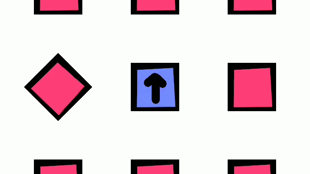
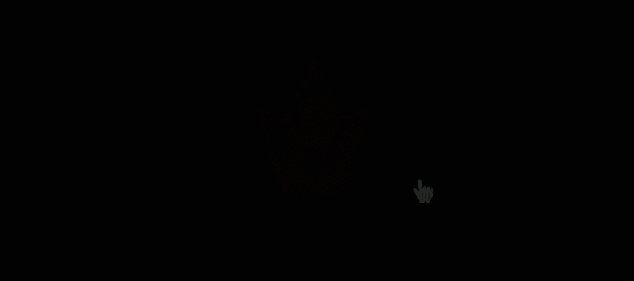
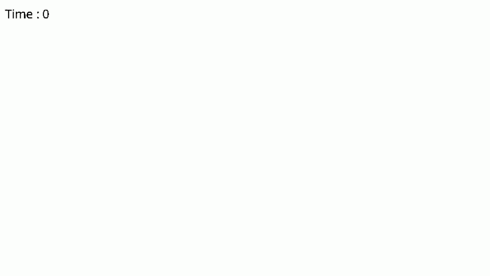

# Nexus Engine

Nexus Engine is a 2D game engine built with C++ and Lua, featuring multiplayer support, component-based architecture, Box2D physics, and data-oriented particle systems. The C++ core handles rendering and physics, while Lua scripts define game logic.

“Nexus” means a point of connection, reflecting the engine's multiplayer feature and the shared experiences it enables.

[Project Website](https://NieZhe08.github.io/GameEngine/) · [Watch the Multiplayer Demo](https://youtu.be/S0F-CeZQty8)

## Technical Highlights

### Multiplayer

Multiplayer is the engine's custom feature, bringing players together in a shared game experience. See it in action in the [multiplayer demo](https://youtu.be/S0F-CeZQty8).

### Lua Script Hosting & Game Logic

An embedded Lua runtime separates game logic from the engine core.

- **C++/Lua integration:** LuaBridge exposes engine functionality to scripts. C++ handles rendering and physics, while Lua manages Actor lifecycle callbacks such as `OnStart` and `OnUpdate`.
- **Dynamic property injection:** JSON configuration overrides Lua component properties at runtime, allowing game values to be adjusted without recompiling the engine.
- **Script error handling:** Protected script calls and exception handling at the C++ boundary help isolate script errors during development.

### Box2D Physics Integration

Box2D physics is exposed through the engine's component system.

- **C++/Lua components:** Native physics components expose APIs to Lua, combining C++ physics updates with script-driven gameplay.
- **Collision filtering:** `categoryBits` and `maskBits` control which objects interact, reducing unnecessary collision processing.
- **Triggers:** Script callbacks respond to physics interactions and trigger events.

### Data-Oriented Particle Systems

The particle system uses data-oriented design for workloads involving large numbers of particles.

- **Cache-friendly storage:** Contiguous Structure-of-Arrays (SoA) storage improves memory locality.
- **Focused update loops:** Particle updates concentrate on the data needed for simulation, supporting efficient iteration and SIMD-friendly computation.

### Scene Management & Serialization

- **Actor templates and inheritance:** JSON-based Actor templates support reusable definitions and property overrides, similar to prefabs.
- **Persistence across scenes:** `DontDestroyOnLoad` keeps selected objects alive during scene transitions, allowing audio managers and score trackers to retain their state.

## Tech Stack

| Area | Technology |
| --- | --- |
| Core language | Modern C++ (C++17/20) |
| Scripting | Embedded Lua with LuaBridge |
| Physics | Box2D |
| Rendering and input | SDL2 |
| Scene and template data | JSON (RapidJSON) |

## Sample Projects

### The Whispering Crown

Demonstrates complex Lua scripting and scene transitions.

### Donna the Donut Pilot

Showcases responsive input feedback and dynamic character control.

### Physics Playground

Demonstrates Box2D physics integration.

## Contact

Interested in multiplayer, Lua bindings, data-oriented optimization, or physics integration? Visit the [GitHub repository](https://github.com/NieZhe08/GameEngine) to explore the implementation and get in touch.
